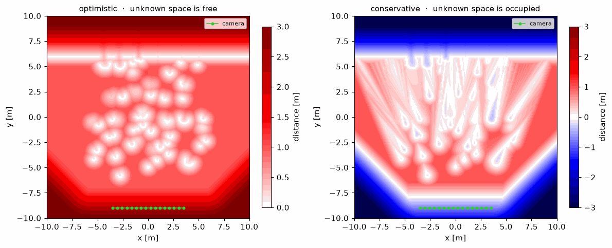
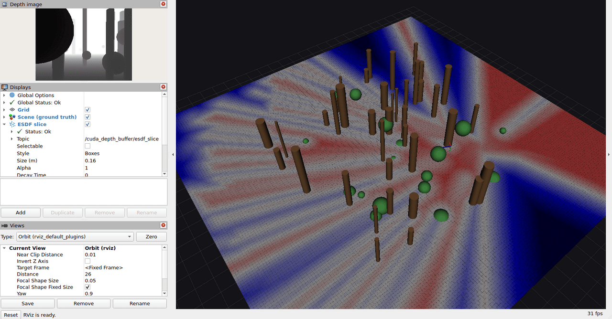

# cuda-depth-buffer

GPU-accelerated Euclidean signed distance queries evaluated directly on a buffer of
posed depth images, without constructing a map. This repository contains the
implementation of the method presented in *Low-Latency Mapless ESDF Queries for MAV
Reactive Collision Avoidance*, accepted for publication in the IEEE Robotics and
Automation Letters (RA-L), 2026. Videos and further results are available on the
[project page](https://ethz-mrl.github.io/mapless-esdf).



## Overview

Collision avoidance planners commonly obtain distances from a volumetric map, into
which depth images are integrated and through which distances are propagated. The
memory of such a map grows with the explored volume, and a new depth image affects
the distance field only after it has been integrated.

This library maintains a circular buffer of *N* posed depth images and evaluates each
query directly on these images. A frame can be queried immediately after insertion
and is discarded once its slot is overwritten. Optionally, one slot holds the latest
frame while the remaining slots hold keyframes. The spatial resolution is determined
by the pixel footprint of the camera instead of a voxel size, and the memory
footprint remains constant during operation.

Since the buffer covers only the space observed in the buffered frames, the library
is intended for reactive collision avoidance, for example on micro aerial vehicles,
where distances are required in the vicinity of the current position.

### Support for Optimistic and Conservative Handling of Unknown Space

Queries support two treatments of space that no buffered frame has observed.

| | Unobserved Space Is Treated As | Distance To |
|---|---|---|
| **Optimistic** | free | the nearest point back-projected from a depth pixel |
| **Conservative** | occupied | the nearest observed surface or boundary of unknown space, signed |

The boundary of unknown space comprises the depth discontinuities that occlude the
volume behind them, the side planes of the camera frustum, and the near plane. The
conservative distance is negative inside unknown space. In the figure above, blue
denotes space that no frame has observed, red denotes space observed as free, and the
white band between them marks the boundary of unknown space.

The optimistic distance is an intermediate result of the conservative query and is
returned with every query. The conservative distance is computed only on request, and
omitting it reduces the query time by nearly half. A planner can use either distance
or both.

## Quick Start

### Python

```bash
pip install .        # builds from source against the local CUDA toolkit
```

```python
import numpy as np
from cuda_depth_buffer import BufferParams, CameraIntrinsics, CudaDepthBuffer

intrinsics = CameraIntrinsics(fx=400, fy=400, cx=319.5, cy=239.5,
                              width=640, height=480, z_near=0.2, z_far=20.0)
buffer = CudaDepthBuffer(intrinsics, BufferParams(num_frames=20))

buffer.set_posed_depth_image(depth, pose, stamp_ns=0)   # pose is x y z qx qy qz qw

result = buffer.query(points, conservative=True, truncation_radius=2.5)
result.conservative_distance   # (N,)   signed distance in metres
result.conservative_gradient   # (N, 3) gradient of the signed distance
result.conservative_closest    # (N, 3) closest point on a surface or occlusion boundary
```

Depth images and query points can be passed as NumPy arrays or as any CUDA array that
implements `__cuda_array_interface__` or DLPack. PyTorch tensors and CuPy arrays on
the GPU are accessed in place, without a copy through host memory.

The notebook [`examples/python/demo.ipynb`](examples/python/demo.ipynb) demonstrates
the interface on a camera trajectory past a procedurally generated forest. All of its
figures are computed at run time.

### C++

```cpp
#include <mrl/cuda_depth_buffer/depth_buffer.hpp>

mrl::CudaDepthBuffer buffer(intrinsics, params);
buffer.setPosedDepthImage(depth, pose, stamp_ns);

mrl::QueryResults results;
buffer.query(queries, num_queries, /*conservative=*/true, results, 2.5f);
```

```cmake
find_package(cuda_depth_buffer REQUIRED)
target_link_libraries(your_target PRIVATE mrl::cuda_depth_buffer)
```

The public headers contain no CUDA code, so translation units that include them do
not have to be compiled with nvcc.

### ROS 2

The ROS 2 node is implemented as a component and can therefore run in the process of
the camera driver, which allows depth images to be received without a copy.
[`ros/README.md`](ros/README.md) documents its interfaces, and
[`examples/ros/`](examples/ros/README.md) provides a demonstration that generates its
own bag file and visualizes the result in RViz.



## Runtime Cost

The following numbers are reported in the paper and were measured on an NVIDIA Jetson
Orin NX with 16 GB of shared memory. The data are forest sequences recorded with a
RealSense D455 (depth range 0.7 m to 5 m) and posed by OKVIS2-X, with *N* = 5 frames
in the buffer and a truncation radius of 1 m. Depth images can be min-pooled with a
*p*×*p* kernel on insertion (`min_pool_size`), which trades accuracy for query time,
and the paper evaluates *p* = 1, 3, 7, 14, and 27. Total latency denotes the time from
the start of the last frame integration to the answer of the last query.

| Metric | Value |
|---|---|
| Pre-processing per frame, median | 0.26 ms to 0.37 ms, depending on *p* |
| Total latency of 400 queries, full resolution (*p* = 1) | 6.2 ms |
| Total latency of 400 queries, all pooling levels | 3.3 ms to 6.2 ms |
| Memory of five full-resolution frames | 5.9 MiB |

Under the same conditions, NVBlox requires a total latency of 199 ms at a voxel size
of 2 cm and 11 ms at 20 cm, almost entirely for pre-processing, and occupies 66 MiB at
2 cm. KD-tree and mesh baselines over the same pixels have a higher total latency than
this library at every pooling level, because they construct an acceleration structure
for each frame. At matched
resolution, a voxel grid reaches a lower total latency only beyond approximately
9.3×10³ queries (NVBlox at 10 cm against *p* = 14), more than an order of magnitude
above the 400 queries of one update of the model predictive controller in the paper.

During the real-world flights, with the complete autonomy stack running on the Orin
NX and depth images min-pooled to 160×120 pixels, the median pre-processing time was
1.2 ms per frame and the query time 53 µs to 55 µs per point.

The throughput on other hardware can be measured with
[`benchmark/query_benchmark.cpp`](benchmark/query_benchmark.cpp), which is built with
`CUDA_DEPTH_BUFFER_BUILD_BENCHMARK=ON`.

## How It Works

The optimistic distance is the distance to the back-projected depth pixel closest to
the query point over all pixels of all buffered frames, which are evaluated in
parallel. To avoid evaluating every pixel, the search is formulated as a
branch-and-bound over a two-level hierarchy. On insertion of a frame, the minimum and
maximum depth are stored for every tile of 32×16 pixels and for every macro tile of
8×8 tiles. The depth range and the pixel extent of a tile define a box in camera
coordinates, whose distance to the query point is a lower bound on the distance to
any point in the tile. Tiles whose lower bound exceeds the current best distance are
pruned without reading their pixels.

The effectiveness of the pruning depends on how early a close candidate is found. The
query point is therefore projected into each frame, and the tile that contains its
projection is evaluated first. The search domain is then recomputed from the
resulting distance, and the remaining tiles are traversed outward from the projected
pixel, so that close candidates are evaluated early. Each candidate is encoded in a
single 64-bit key whose upper 32 bits hold its squared distance, so that the minimum
over all candidates is obtained with a single `atomicMin`.

For the conservative distance, occlusion boundaries are modelled as segments on the
camera rays of the depth pixels, each bounded by the depth of its pixel and the depth
of the adjacent pixel closest to the projection of the query point. The nearest
segment is determined by the same search, with the optimistic distance as the
truncation radius. The signed distances of all frames are then merged by taking
their maximum, so a point is reported as free if any frame has observed it as free.

Each frame can carry a pose covariance. Obstacles observed in a frame are then
inflated by a margin of *c* standard deviations of the pose uncertainty, propagated
to the query point through its lever arm from the camera center
(`pose_covariance_confidence`, default *c* = 4 as in the paper). This limits the
extent to which a frame with a large pose error can erode obstacles observed in
other frames. The effectiveness of this compensation depends on the accuracy of the
covariance.

All pruning bounds are scaled by a factor slightly below one before they are
compared, so candidates that tie the current minimum are never discarded, and the
result matches that of an exhaustive search over all pixels.

Section III of the paper gives a formal description of the method. The two-level tile
hierarchy, the search order, and the scaling of the bounds are implementation details
that the paper does not cover and that are documented only here.

## Building

The library requires CUDA, CMake 3.20 or newer, Eigen, and yaml-cpp.

```bash
cmake -S . -B build -DCMAKE_BUILD_TYPE=Release
cmake --build build -j
ctest --test-dir build --output-on-failure
```

`CMAKE_CUDA_ARCHITECTURES` defaults to `native`, or to a list of architectures if no
GPU is visible during configuration. For cross-compilation it must be set explicitly,
for example `-DCMAKE_CUDA_ARCHITECTURES=87` for a Jetson Orin.

| Option | Description | Default |
|---|---|---|
| `CUDA_DEPTH_BUFFER_BUILD_TESTS` | Unit and system tests | `ON` |
| `CUDA_DEPTH_BUFFER_BUILD_EXAMPLES` | C++ examples | `ON` |
| `CUDA_DEPTH_BUFFER_BUILD_BENCHMARK` | Throughput benchmark | `OFF` |
| `CUDA_DEPTH_BUFFER_BUILD_PYTHON` | Python extension | `OFF` |
| `CUDA_DEPTH_BUFFER_ENABLE_PROFILING` | Per-stage timing | `ON` |

Two Docker images are provided. `Dockerfile.dev` builds and tests the library, and
`Dockerfile.ros` builds the ROS 2 node and the RViz demonstration.

## Testing

The tests do not rely on recorded data. Scenes are composed of geometric primitives
with closed-form ray intersections, so depth images are computed analytically and the
geometry is known exactly. Query results are compared against an exhaustive search
over all pixels of all frames (`bruteForceDistances`).

The pruning bounds are tested separately. A bound that is too large discards valid
candidates, and the query then overestimates the clearance without any indication in
its output. Each bound is therefore verified against the complete set of points it
has to cover. The tile bound is verified against every pixel of the tile, with the
depth minimised in closed form, and the bound on the projected bounding box against
the entire pixel grid.

Four of the six test executables do not require a GPU, and `ctest -LE gpu` runs only
these.

## Repository Layout

```
include/mrl/cuda_depth_buffer/   public API, plain C++
src/                             implementation
src/kernels/                     one header per stage of the query
python/                          pybind11 bindings and their tests
ros/                             ROS 2 packages
examples/                        notebook, threading example, and RViz demonstration
benchmark/                       throughput benchmark on a generated scene
test/                            unit and system tests
```

## Citation

If you use this library in your research, please cite the paper. It has been accepted
for publication in the IEEE Robotics and Automation Letters, and the arXiv preprint is
the current version.

```bibtex
@misc{freissmuth2026mapless,
    title={Low-Latency Mapless {ESDF} Queries for {MAV} Reactive Collision Avoidance},
    author={Freissmuth, Leonard and Le Gentil, Cedric and Oleynikova, Helen and Leutenegger, Stefan},
    year={2026},
    eprint={2610.13158},
    archivePrefix={arXiv},
    primaryClass={cs.RO},
    url={https://arxiv.org/abs/2610.13158}
}
```

## License

This project is released under the BSD 3-Clause License. See [`LICENSE`](LICENSE).
