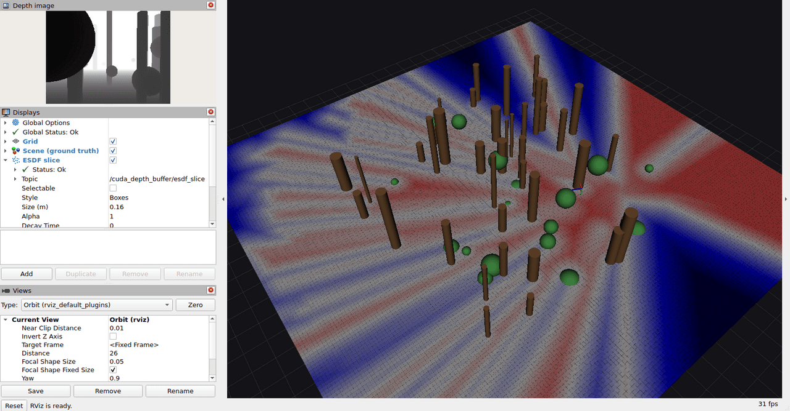

# The whole thing, in RViz

A camera flies through a forest, and the space around it is coloured by how far
away the nearest obstacle is. No map is built. Every frame the buffer holds is a
depth image and a pose; every colour in the picture was computed from those, on
demand, in the last few milliseconds.



Blue is space no camera has seen, red is space some camera saw and found empty,
and white is the boundary between them. Watch the blue wedges behind the trunks:
those are occlusion shadows, and they close as the camera flies round and sees
behind the tree. Watch the blue creep back in behind the camera too, as the
frames that saw that stretch fall out of the ring.

Everything is generated. There is no dataset to download.

## 1. Build the image

```bash
docker build -f Dockerfile.ros -t cuda-depth-buffer:ros .
```

## 2. Make the bag

The generator renders the scene, so it runs in the container, which has both
rosbag2 and the Python bindings:

```bash
docker run --rm --gpus all -v "$PWD:/repo" cuda-depth-buffer:ros \
  python3 /repo/examples/ros/make_bag.py --output /repo/examples/ros/data/forest
```

Twenty seconds of flight at 15 Hz, about 300 depth images. `--help` lists the
knobs: `--seed` picks a different forest, `--speed` and `--frames` change how far
it gets, `--no-covariance` leaves the pose uncertainty out.

What goes into the bag:

| topic | |
|---|---|
| `/camera/depth/image_rect_raw` | 32FC1 depth, metres |
| `/camera/depth/camera_info` | the geometry it was rendered with |
| `/odometry/pose` | camera pose in `odom` |
| `/odometry/pose_with_covariance` | the same pose, with a drifting covariance |
| `/tf` | `odom` → `camera`, so `pose_source: tf` works too |
| `/scene/markers` | the true geometry, as RViz markers |

That last one is what a generated scene buys you: the trunks and bushes RViz
draws are exactly the surfaces the depth images were rendered from, so what the
buffer reconstructs can be laid over what is actually there.

## 3. Run it

Two terminals into the same container. Start it:

```bash
docker run --rm -it --gpus all --net=host --ipc=host \
  -e DISPLAY -v /tmp/.X11-unix:/tmp/.X11-unix \
  -v "$PWD:/repo" --name cdb-demo cuda-depth-buffer:ros bash
```

Inside, bring up the node and RViz:

```bash
ros2 launch /repo/examples/ros/demo.launch.py
```

Then in a second terminal, play the bag — paused, so nothing moves until you say
so:

```bash
docker exec -it cdb-demo /ros_entrypoint.sh \
  ros2 bag play /repo/examples/ros/data/forest --clock --start-paused --loop
```

`ros2 bag play` reads the keyboard: **space** plays and pauses, **s** steps one
message while paused. The node runs on the bag's clock, so pausing the playback
pauses the slice with it rather than leaving it recomputing the same answer.

If `xhost` is refusing the container a window, `xhost +local:docker` on the host
is the usual fix.

## What to try

- **Pause and step.** Watch the slice appear one frame at a time. Nothing is
  accumulated; each redraw is a fresh answer from whatever the ring holds.
- **Turn off the ESDF slice display in RViz.** The node stops computing it
  entirely — it is only ever produced while something is subscribed.
- **`--loop`.** The second time round the same stretch, the answer is the same:
  there is no state that drifts, because there is no state.
- **Change the slice height.** `ros2 launch ... slice_height:=2.5` puts the
  plane above the bushes.
- **Turn the pose compensation off.** `pose_covariance_confidence:=0.0`. The
  obstacles stop being inflated by the odometry's uncertainty, and the free
  space grows by tens of centimetres by the end of the flight, where the
  covariance in the bag has drifted furthest.
- **Ask a question directly.**

  ```bash
  ros2 service call /cuda_depth_buffer/query \
    cuda_depth_buffer_msgs/srv/QueryDistances \
    "{points: [0.0, 0.0, 1.0], conservative: true, truncation_radius: 3.0}"
  ```

- **Use tf instead of the pose topic.** `ros2 launch ... ` with the node's
  `pose_source` set to `tf`; the bag carries both.

## The covariance in the bag

Odometry has no absolute reference, so its uncertainty accumulates with distance
travelled and never comes back down. The bag models that: a diagonal covariance
whose standard deviations grow as the square root of the path length, which is
what an unbiased random walk gives. By the end of a twenty second flight it is
about ten centimetres of position sigma.

The buffer uses it to inflate the obstacles a frame saw by that frame's own
uncertainty, so a frame the odometry has lost track of cannot erode an obstacle
a confident frame put there. Frames without a covariance contribute no margin,
which is why `--no-covariance` turns the whole thing off as surely as
`pose_covariance_confidence: 0.0` does.
